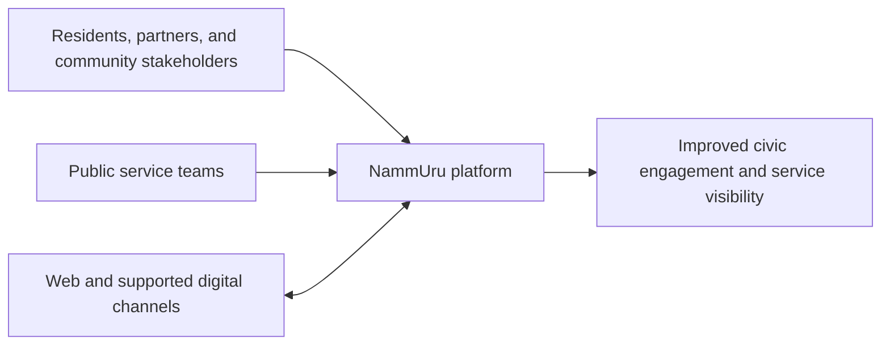

# NammUru — Brief Solution Architecture

**NammUru** is a digital platform for civic engagement and local governance. It helps residents, public-service teams, and community partners connect around civic needs and information.

This page presents a public-facing overview of the platform and intentionally avoids exposing internal infrastructure, deployment topology, operational procedures, or sensitive implementation details.

## Purpose

- Civic participation and communication
- Location-aware civic information
- Issue and service-request engagement
- Community and partner participation
- Reporting and public-service insights
- Web and supported digital-channel experiences

These are business-facing capabilities and do not describe internal system boundaries, service layouts, or technical implementation details.

## High-level view

The diagram is conceptual and intentionally omits internal architecture, hosting details, and operational flow specifics.

## Public-facing principles

NammUru’s public materials are designed to communicate product value without disclosing sensitive system details. Access to operational information and internal service infrastructure should follow the applicable privacy, security, and governance policies.

---

© NammUru
