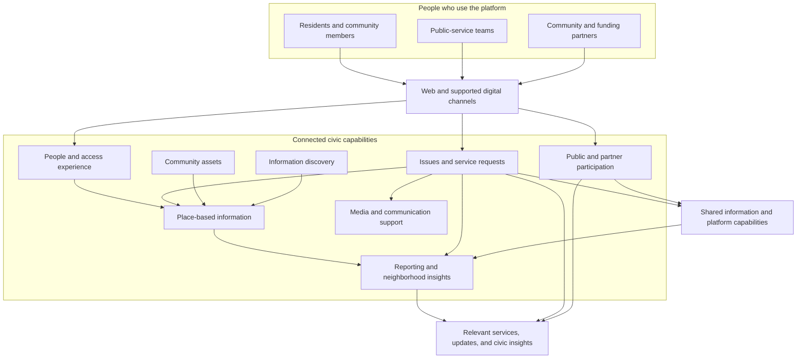
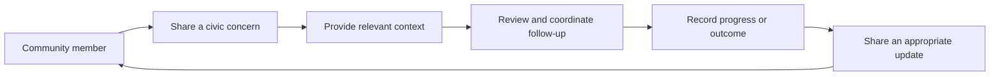
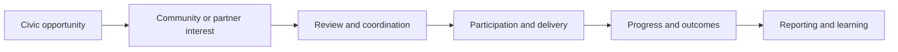
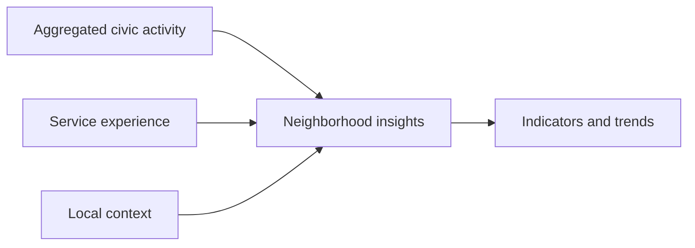
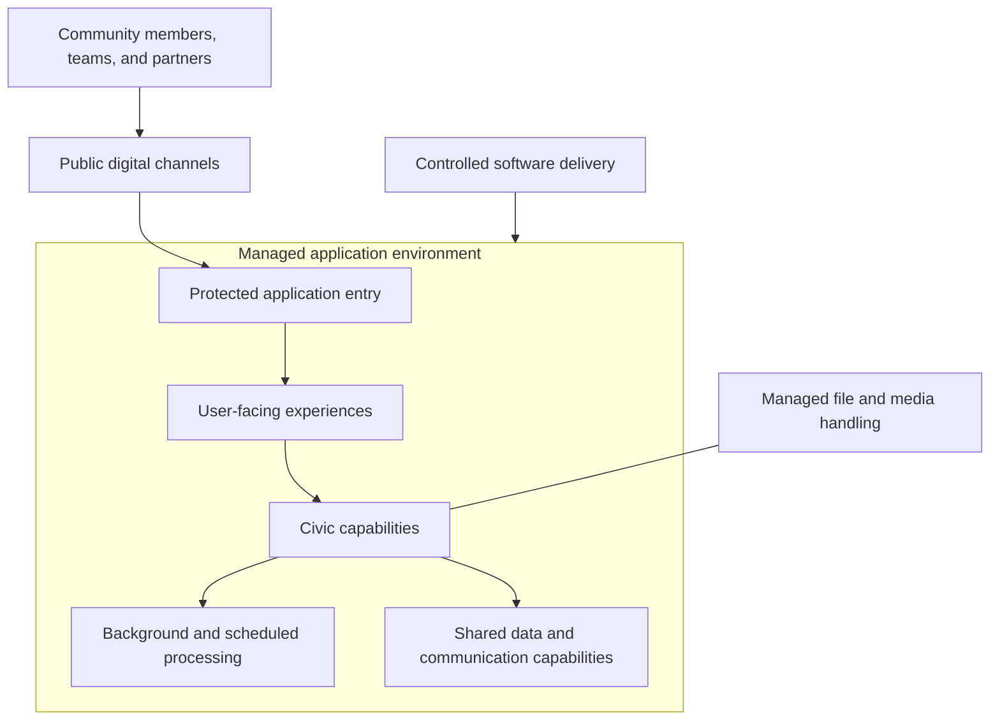
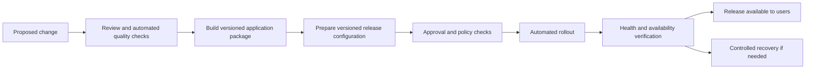

# NammUru — Brief Solution Architecture

## Overview

NammUru is a digital platform for civic engagement and local governance. It helps residents, public-service teams, and community partners connect around civic needs, local information, and service outcomes.

This public overview describes the platform in business and conceptual terms. It intentionally omits internal product-service names, environment and hosting identifiers, detailed system topology, operational procedures, and security-sensitive implementation information.

## Product capabilities and service areas

The platform brings together complementary service areas that support civic participation and public-service delivery:

| Service area | Public-facing responsibility |
| --- | --- |
| People and access | Provides a consistent experience for community members, public-service teams, and partners, with access appropriate to each audience. |
| Place-based information | Relates civic information to neighborhoods and administrative areas to provide local context. |
| Community assets | Organizes information about civic infrastructure and shared community resources. |
| Issues and service requests | Supports reporting concerns, coordinating follow-up, and communicating progress or outcomes. |
| Planning and funding | Connects civic priorities with funding opportunities and community or partner participation. |
| Media understanding | Supports review of relevant submitted media where appropriate; automated assistance does not replace human or policy review. |
| Notifications and communications | Provides relevant updates through available communication channels. |
| Public engagement | Enables community input and proposals, including petition-style participation. |
| Reporting and insights | Helps teams and communities understand service activity, local conditions, and trends. |
| Neighborhood indicators | Presents high-level information about civic service experience and neighborhood liveability. |
| Information discovery | Makes civic information easier to explore and access through supported digital interactions. |
| Web and channel experience | Offers user-facing digital experiences across supported channels. |

These are capability descriptions, not internal component names, deployment units, or a map of system boundaries. Capabilities may be combined or delivered differently as the platform evolves.

## System design

At a public level, NammUru can be understood as a set of user experiences, civic capabilities, and shared supporting capabilities. User experiences bring together the relevant civic capabilities for each journey. Common support functions provide appropriate information handling, communications, and reporting. Not every capability participates in every interaction.

This conceptual system design describes product relationships only. It does not expose internal component names, interfaces, network paths, data stores, or security configuration.

## Example civic flows

### Reporting and following up on a concern

A community member shares a civic concern through an available digital channel and may provide useful context such as a place or supporting media. The platform helps make the information available for appropriate review and follow-up. Updates can be shared as the concern progresses, subject to the relevant service process.

### Coordinating community or partner participation

Civic opportunities can be connected with partner interest, review, coordinated participation, delivery, and outcome reporting. This illustrates a broad engagement journey and does not disclose approval rules or financial controls.

### Understanding neighborhood conditions

Civic activity, service experience, and local context can inform community-level indicators and trends. Measures and interpretation are governed by the relevant product owners; this overview does not publish scoring formulas, thresholds, or individual-level data.

## Service collaboration design

The service areas collaborate to support end-to-end civic journeys. For example, a user-facing experience can combine access and place context with issue handling, optional media assistance, communications, and reporting. Partner participation can combine opportunity information, coordination, progress tracking, and outcome reporting. Insights can draw on suitable, governed civic information and local context.

Not every capability is involved in every interaction. Information should be shared only as needed for the relevant purpose, with appropriate privacy, access, retention, and governance controls. Public materials describe these collaborations at a conceptual level and do not expose internal interfaces, detailed data flows, or access-control rules.

## Deployment architecture

The platform is designed as a set of digital capabilities delivered through a managed application environment. Public traffic reaches the application through a protected entry layer. Application capabilities use shared platform resources as needed, and background processing can handle work that does not need to complete within a user's immediate interaction. Persistent information and uploaded files are handled by managed storage capabilities.

The diagram is deliberately generic and does not identify vendors, regions, instances, namespaces, internal routes, or specific software products.

### Deployment process design

A release follows a controlled, repeatable lifecycle. A change is reviewed and checked; a versioned application package is produced; release configuration identifies the intended version; and an automated deployment process applies the approved configuration to the managed environment. Health and availability checks provide feedback after rollout. If an issue is detected, the release process should support controlled recovery to a previously approved version.

### Deployment principles

- **Traceable releases:** Application packages and release configuration should be versioned so changes can be associated with an approved source revision.
- **Separation of responsibilities:** Building and testing software, managing release configuration, deploying application workloads, and provisioning the underlying cloud foundation are distinct activities.
- **Configuration as code:** Environment-specific settings should be managed through controlled configuration rather than copied or manually edited during release.
- **Gradual and verifiable rollout:** Releases should be checked for expected health and availability, with recovery procedures maintained for operational use.
- **Least exposure:** Public access should be limited to intended user-facing capabilities. Internal operational interfaces and sensitive configuration are not part of this public architecture description.
- **Environment flexibility:** Capabilities and supporting resources may differ by environment; the approved internal deployment configuration is authoritative.

This section summarizes design principles only. It is not a runbook and does not disclose deployment commands, private endpoints, infrastructure identifiers, privileged workflows, or environment-specific settings.

## Security, privacy, and scope

NammUru's public materials focus on user-facing capabilities and outcomes. Detailed access-control design, internal component names, infrastructure identifiers, private data flows, configuration, and operational procedures are intentionally not included here. Sensitive implementation and operational documentation should be maintained separately and shared only with appropriate audiences.

This brief is a public solution overview, not a production topology specification. Capability descriptions and diagrams should be reviewed as the product evolves.

---

© NammUru
