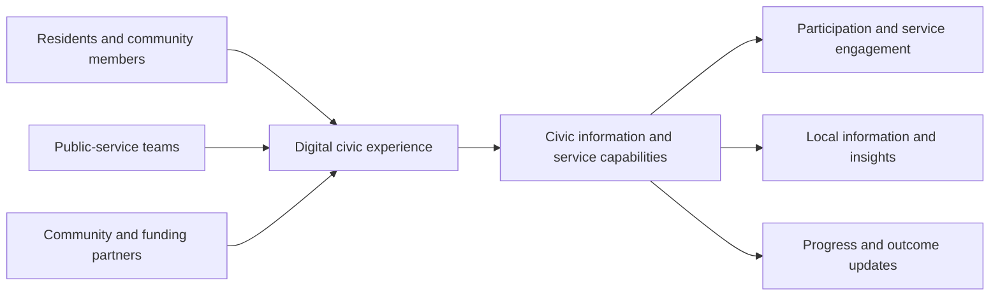
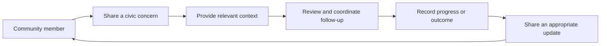
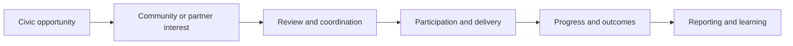
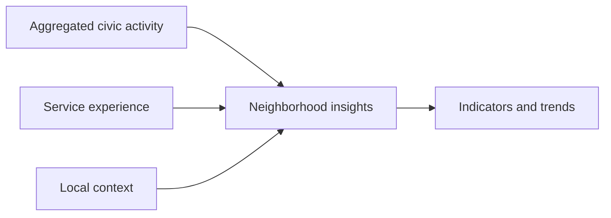
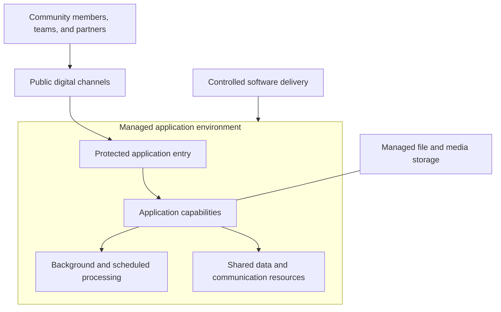
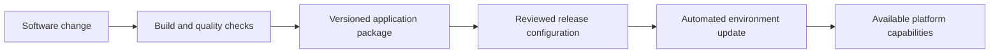

# NammUru — Brief Solution Architecture

## Overview

NammUru is a digital platform for civic engagement and local governance. It helps residents, public-service teams, and community partners connect around civic needs, local information, and service outcomes.

This public overview describes the platform in business and conceptual terms. It intentionally omits internal product-service names, environment and hosting identifiers, detailed system topology, operational procedures, and security-sensitive implementation information.

## Product capabilities

The platform brings together capabilities that support civic participation and service delivery:

- **People and access experience:** Provides a consistent experience for community members, public-service teams, and partners, with access appropriate to each audience.
- **Place-based information:** Relates civic information to neighborhoods and administrative areas so that people can understand local context.
- **Community assets:** Organizes information about civic infrastructure and shared community resources.
- **Issue and service engagement:** Supports reporting concerns, coordinating follow-up, and communicating progress or outcomes.
- **Planning and participation:** Helps connect civic priorities with funding opportunities and community or partner participation.
- **Media and communication support:** Supports relevant submitted content and timely updates through available channels.
- **Public engagement:** Enables community input and proposals, including petition-style participation.
- **Insights and reporting:** Helps teams and communities understand service activity, local conditions, and trends.
- **Neighborhood indicators:** Presents high-level information about civic service experience and neighborhood liveability.
- **Information discovery:** Makes civic information easier to explore and access through supported digital interactions.

These are capability descriptions, not internal component names or a map of system boundaries.

## Conceptual platform view

This is a product-level view only. It does not show internal service names, network paths, or data-store connections.

## Example civic flows

### Reporting and following up on a concern

A community member shares a civic concern through an available digital channel and may provide useful context such as a place or supporting media. The platform helps make the information available for appropriate review and follow-up. Updates can be shared as the concern progresses, subject to the relevant service process.

### Coordinating community or partner participation

Civic opportunities can be connected with partner interest, review, coordinated participation, delivery, and outcome reporting. This illustrates a broad engagement journey and does not disclose approval rules or financial controls.

### Understanding neighborhood conditions

Civic activity, service experience, and local context can inform community-level indicators and trends. Measures and interpretation are governed by the relevant product owners; this overview does not publish scoring formulas, thresholds, or individual-level data.

## Conceptual deployment architecture

The platform is designed as a set of digital capabilities delivered through a managed application environment. Public traffic reaches the application through a protected entry layer. Application capabilities use shared platform resources as needed. The diagram is deliberately generic and does not identify vendors, regions, instances, namespaces, internal routes, or specific software products.

### Delivery approach

Changes are checked and packaged through an automated delivery process. Versioned release configuration is used to promote application updates into the managed runtime. Cloud foundation provisioning and application release are separate responsibilities. Environment-specific settings and optional capabilities can vary, and should be governed through the appropriate internal processes.

This diagram communicates the release concept only; it is not an operational runbook or a description of a specific production environment.

## Security, privacy, and scope

NammUru's public materials focus on user-facing capabilities and outcomes. Detailed access-control design, internal component names, infrastructure identifiers, private data flows, configuration, and operational procedures are intentionally not included here. Sensitive implementation and operational documentation should be maintained separately and shared only with appropriate audiences.

This brief is a public solution overview, not a production topology specification. Capability descriptions and diagrams should be reviewed as the product evolves.

---

© NammUru
